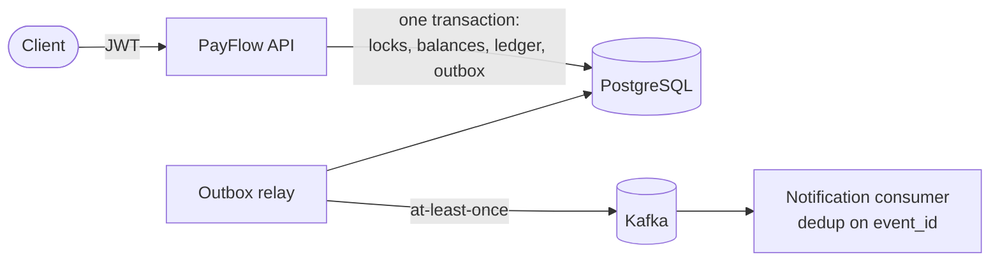

# PayFlow

A payment-processing backend built to get the hard parts of moving money
right: atomic transfers under concurrency, idempotent retries, a double-entry
ledger that reconciles, authorization by account ownership, and reliable
event publication.

> **Status:** a complete, tested portfolio system. It has **not** been through
> the security review, compliance work (e.g. PCI DSS), or production load
> testing a real financial institution requires. See
> [Known limitations](#known-limitations).

## What it solves

| Problem | How PayFlow handles it | Evidence |
| --- | --- | --- |
| Two requests overspend one account | Row locks (`SELECT … FOR UPDATE`); the balance check runs under the lock; DB `CHECK (balance >= 0)` | 25-way overdraw race: exactly the affordable 10 succeed |
| Opposite transfers deadlock | Locks taken in account-number order | 40 concurrent A↔B transfers, no deadlock |
| A failure halfway leaves money half-moved | Debit, credit, ledger, idempotency claim and event commit in **one** transaction | Trigger-forced failures roll back everything |
| Client retries charge twice | `Idempotency-Key` with a DB unique constraint per caller, request fingerprint, replay of the original 201 | 10 concurrent duplicates move money once; replay survives a restart |
| Balances drift from history | Double-entry ledger, append-only, balanced at commit by a deferred trigger, plus a reconciliation report | Reconciles after ~340k load-test transfers |
| Users touch others' money | JWT auth; ownership enforced under the row lock; non-owned resources are 404 | Authorization matrix tests |
| Events lost or sent for rolled-back transfers | Transactional outbox, leased relay, at-least-once delivery to Kafka, deduplicating consumer, DLT | End-to-end Kafka test including redelivery |

## Stack

Java 25 · Spring Boot 4.1 (Web MVC, Data JPA / Hibernate 7, Security OAuth2
resource server, Kafka, Actuator) · PostgreSQL 17 · Flyway · Kafka 4.2 (KRaft)
· Micrometer / Prometheus · springdoc OpenAPI · JUnit 5, Testcontainers, H2 ·
k6 · Docker · GitHub Actions

## Architecture



Details, sequence diagrams, and design decisions:
[docs/ARCHITECTURE.md](docs/ARCHITECTURE.md).

| Doc | Contents |
| --- | --- |
| [ARCHITECTURE.md](docs/ARCHITECTURE.md) | Components, schema, transfer/rollback/idempotency/outbox flows, locking, ledger, Redis decision |
| [API.md](docs/API.md) | Endpoints, examples, request rules, error codes |
| [SECURITY.md](docs/SECURITY.md) | Authentication, authorization matrix, data protection |
| [TESTING.md](docs/TESTING.md) | Suites, what each proves, commands |
| [PERFORMANCE.md](docs/PERFORMANCE.md) | Measured k6 results and the relay bottleneck that was fixed |
| [OPERATIONS.md](docs/OPERATIONS.md) | Configuration, upgrades, metrics, alerts, runbooks |
| [IMPLEMENTATION_PLAN.md](docs/IMPLEMENTATION_PLAN.md) | Audit findings and the evidence-backed checklist |

## Quick start

Requirements: JDK 25, Docker.

```bash
cp .env.example .env
# edit .env: set DB_PASSWORD and PAYFLOW_JWT_SECRET (openssl rand -base64 48)
docker compose up --build -d          # PostgreSQL :5433, Kafka, API :8080
set -a; . ./.env; set +a

TOKEN=$(scripts/dev-token.sh dev-user)        # owns the seeded PF10001 (1000.00 INR)
curl -s localhost:8080/api/v1/accounts/PF10001/balance -H "Authorization: Bearer $TOKEN"
```

Open an account for someone else and pay them:

```bash
BOB=$(scripts/dev-token.sh bob)
curl -s -X POST localhost:8080/api/v1/accounts -H "Authorization: Bearer $BOB" \
  -H 'Content-Type: application/json' -d '{"accountNumber":"BOB-001","currency":"INR"}'

curl -s -i -X POST localhost:8080/api/v1/transfers -H "Authorization: Bearer $TOKEN" \
  -H 'Content-Type: application/json' -H 'Idempotency-Key: first-payment' \
  -d '{"fromAccountNumber":"PF10001","toAccountNumber":"BOB-001","amount":125.50,"currency":"INR"}'
```

Repeat the same transfer command: you get the same `transactionReference`,
`Idempotent-Replayed: true`, and no second debit. More in
[docs/API.md](docs/API.md). Swagger UI: <http://localhost:8080/swagger-ui.html>.

To run the app from your IDE against an existing local PostgreSQL instead:
`SPRING_PROFILES_ACTIVE=dev` plus `PAYFLOW_JWT_SECRET` (see
[OPERATIONS.md](docs/OPERATIONS.md#running)). **No profile is active by
default**, so a run configuration needs to set one.

## Key behaviors

**Idempotency.** Every money-moving `POST` needs an `Idempotency-Key` (1–255
visible ASCII characters), unique per caller. Same key and same request
replays the original `201` with `Idempotent-Replayed: true`. Same key with a
different request is `409 IDEMPOTENCY_KEY_REUSED`. A rejected request (such
as insufficient funds) stores nothing, so the key stays usable.

**Transactions and locking.** Each transfer is one database transaction. It
locks both account rows in a fixed order with a 3 s lock timeout (503
`LOCK_TIMEOUT`, safe to retry with the same key), checks ownership, status,
currency and funds under the lock, then writes the transfer, ledger entries
and outbox event. Any failure rolls back all of it.

**Ledger.** `balance = Σ credits − Σ debits` for every account. Deposits and
withdrawals post against a per-currency `SYS-FUNDING-<CUR>` account, so the
sum of all balances in a currency is always zero.
`GET /api/v1/admin/reconciliation` verifies this.

**Security.** OAuth 2.0 bearer JWTs, validated for signature, expiry, issuer,
audience and subject. Production uses the identity provider's JWKS; local
development uses an HS256 secret from the environment (there is no default
key). Customers access only their own accounts; `payflow.admin` gates funding,
status changes and reconciliation.

**Events.** `TransferCompleted` and `AccountCreated` are written to the outbox
in the business transaction and relayed to Kafka at least once (key =
aggregate ID). Kafka is optional (`PAYFLOW_KAFKA_ENABLED`); transfers never
depend on it.

## Tests

```bash
./mvnw test      # 76 fast tests (unit + H2), no Docker needed
./mvnw verify    # + 30 PostgreSQL/Kafka integration tests via Testcontainers
```

See [docs/TESTING.md](docs/TESTING.md) for what each suite proves.

## Operations

- Health: `/actuator/health/liveness`, `/actuator/health/readiness` (public)
- Metrics: `/actuator/prometheus` (admin), including `payflow_transfers_total{type,outcome}`,
  `payflow_transfer_duration_seconds`, `payflow_outbox_pending`,
  `payflow_outbox_events_total{outcome}`, and Hikari pool metrics
- Logs: every line carries the request's `X-Request-Id`; JSON (ECS) in `prod`
- CI: [`.github/workflows/ci.yml`](.github/workflows/ci.yml) runs `./mvnw verify`
  with Testcontainers, builds the image, and reviews dependencies on PRs
- Performance: `perf/k6/payflow.js`; 2,340 transfers/s and 966/s on a single
  hot account (p99 23 ms / 55 ms) on a MacBook Air M4. Method and caveats in
  [docs/PERFORMANCE.md](docs/PERFORMANCE.md).

## Known limitations

- Single currency per transfer; no FX.
- No refunds or reversal API. Corrections are new postings, such as a
  compensating transfer.
- No rate limiting (expected at an API gateway) and no token revocation beyond
  expiry.
- One application instance was load-tested. Multi-instance correctness relies
  on the same database locks and `SKIP LOCKED` claims that are tested with
  concurrent threads, but was not run as a cluster.
- The outbox relay's p99 publish lag reaches tens of seconds at saturation on
  one instance (see PERFORMANCE.md).
- Not reviewed for PCI DSS or other regulatory regimes. No penetration test.

## Future improvements

Reversal and refund workflow · multiple relay workers or a separate relay
deployment · rate limiting at the gateway · OpenTelemetry tracing ·
Kubernetes manifests · contract tests for event schemas · hot-account
sharding.
