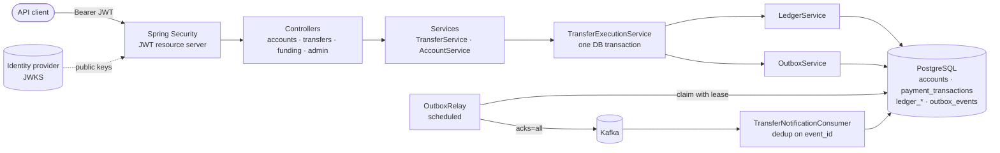
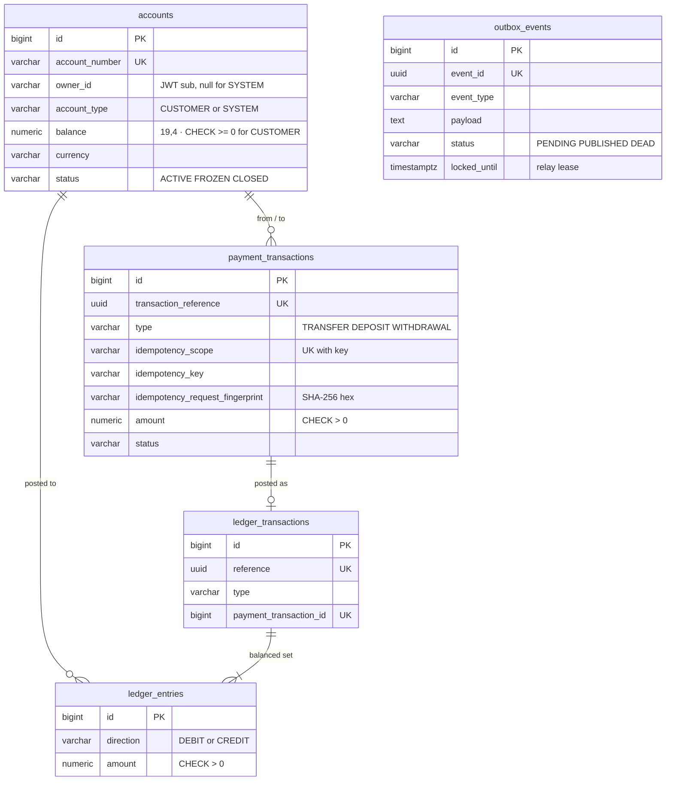
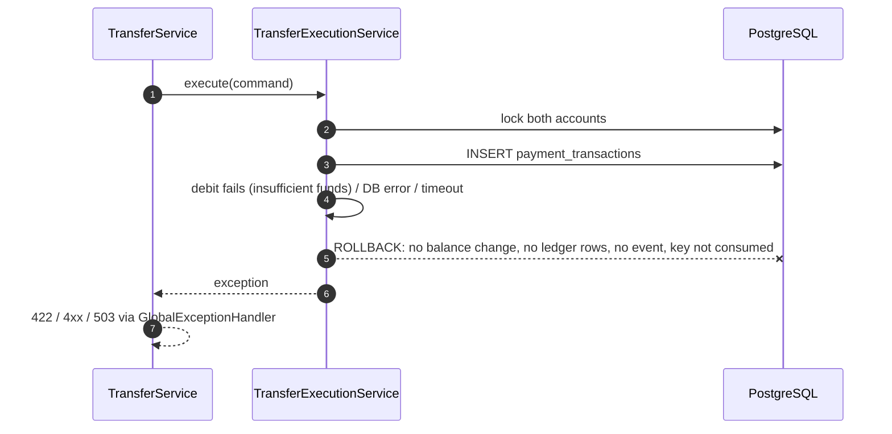
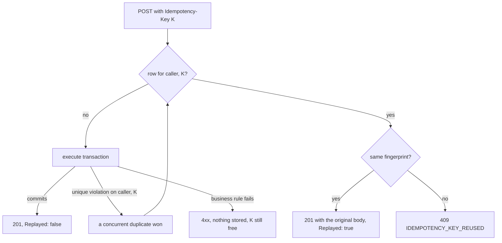

# PayFlow Architecture

PayFlow is a single Spring Boot 4.1 service (Java 25) with PostgreSQL as the
system of record and Kafka as an optional, downstream event bus.

## System



| Component | Responsibility |
| --- | --- |
| `SecurityConfig` | Validates JWTs (signature, exp/nbf, iss, aud, sub). URL-level role rules. JSON 401/403. |
| `CorrelationIdFilter` | `X-Request-Id` in, out, and in every log line and error body |
| `TransferService` | Normalizes and validates input, idempotency (fingerprint, replay, race resolution), metrics. **Not transactional** by design. |
| `TransferExecutionService` | The money-moving transaction: locks, rules, idempotency claim, ledger posting, outbox event |
| `LedgerService` | The only writer of balances; writes balanced, append-only ledger entries |
| `ReconciliationService` | Compares balances to the ledger at `REPEATABLE READ` |
| `OutboxService` / `OutboxRelay` | Transactional outbox and at-least-once relay |
| `GlobalExceptionHandler` | Maps every failure to the stable `ErrorResponse` |

## Data model



Schema changes are Flyway migrations V1–V8 only. Hibernate runs with
`ddl-auto=validate`, so a mapping that disagrees with the schema fails at
startup (this caught D14, see IMPLEMENTATION_PLAN.md). Applied migrations are
never edited; fixes are forward migrations. The upgrade path from a V2
database with live data is tested (`FlywayMigrationPostgresIT`).

## Money transfer

### Successful transfer

```mermaid
sequenceDiagram
    autonumber
    participant C as Client
    participant TS as TransferService
    participant TX as TransferExecutionService (one transaction)
    participant DB as PostgreSQL

    C->>TS: POST /transfers, Idempotency-Key: K
    TS->>TS: validate key, currency, minor units; normalize amount to scale 4
    TS->>DB: find (caller, K)
    DB-->>TS: none
    TS->>TX: execute(command)
    TX->>DB: SELECT ... FOR UPDATE (lower account number first)
    TX->>DB: SELECT ... FOR UPDATE (higher account number)
    TX->>TX: caller owns source? both ACTIVE? currencies match?
    TX->>DB: INSERT payment_transactions (claims (caller, K))
    TX->>DB: UPDATE balances + INSERT ledger_transaction, 2 entries
    TX->>DB: INSERT outbox_events (TransferCompleted)
    TX->>DB: COMMIT (deferred trigger checks ledger balance)
    TX-->>TS: TransferResponse
    TS-->>C: 201 Created, Idempotent-Replayed: false
```

### Failure and rollback



Every step that changes money happens inside one `@Transactional` method, so
there is no partial state. This includes the idempotency claim, both balance
updates, the ledger entries and the outbox event. Tests force failures after
the debit and while completing the transaction record with database
triggers, then assert that nothing changed (`TransferConcurrencyPostgresIT`).

### Locking

- **Pessimistic row locks** (`PESSIMISTIC_WRITE` → `SELECT ... FOR UPDATE`)
  on both accounts. The sufficient-funds check reads the balance *under the
  lock*, so it is the final authority; a balance read outside the
  transaction never is.
- **Deterministic lock order** (ascending account number) means two
  opposite-direction transfers cannot each hold one lock and wait for the
  other. Verified with 40 concurrent A→B / B→A transfers.
- **Bounded waits.** The lock timeout is 3 s and the transaction timeout 10 s.
  A timeout returns 503 `LOCK_TIMEOUT` with `Retry-After`. The key was not
  consumed, so the client can retry with the same key.
- No network calls happen inside the transaction. Kafka publication is done
  later by the relay.
- The database is the last line of defense: `CHECK (balance >= 0)` for
  customers, `CHECK (amount > 0)`, `CHECK (from <> to)`, unique keys, foreign
  keys, and the ledger triggers.

## Idempotency



Decisions:

| Question | Decision |
| --- | --- |
| Key format | 1–255 visible ASCII characters |
| Uniqueness | `UNIQUE (idempotency_scope, idempotency_key)`, where scope is the caller's JWT subject. Enforced by the database, never by check-then-insert. |
| Fingerprint | SHA-256 over NUL-separated normalized fields: from, to, amount at scale 4, uppercase currency. `40`, `40.0` and `40.0000` are the same request. |
| Replay status | The **original 201** and body, plus `Idempotent-Replayed: true`. A client that lost the first response sees exactly what it would have seen. |
| Rejected requests | Not stored; the key stays free. A retry after fixing the cause (such as funding the account) executes normally. |
| Concurrent duplicates | The loser's insert hits the unique index and rolls back. `TransferService` (outside the failed transaction) then replays the winner. |
| "Unknown outcome" | Not observable server-side. The key claim and the money movement commit atomically, so a key is either absent or bound to a completed transfer. If a client times out, it retries with the same key and gets either the original result or a fresh execution. |
| Restarts | Keys live in PostgreSQL; verified across two application contexts |

## Double-entry ledger

- **Sign convention:** for every account, `balance = Σ credits − Σ debits`.
  A transfer debits the sender and credits the receiver.
- **System accounts:** each currency has a `SYS-FUNDING-<CUR>` account (type
  `SYSTEM`, may go negative). A deposit debits it and credits the customer; a
  withdrawal does the reverse. So the **sum of all balances in a currency is
  always zero**, and the funding account's balance is minus the money held.
- **Invariants:** every ledger transaction has at least two entries, equal
  debits and credits, and a single currency matching all its accounts.
  `LedgerService` checks this before writing. A **deferred constraint
  trigger** checks it again at commit, because a `CHECK` cannot see sibling
  rows.
- **Immutability:** `UPDATE` and `DELETE` on ledger tables raise an error.
  Corrections are new postings (for example, a compensating transfer).
- **Reconciliation:** `GET /api/v1/admin/reconciliation` reports per-account
  balance vs. ledger, net per currency, unbalanced postings, and completed
  transfers without a posting. Verified after 120 concurrent mixed operations
  and after about 340k load-test transfers.
- **Backfill:** V6 converts existing completed transfers into postings and any
  unexplained balance into an `OPENING_BALANCE` posting against the funding
  account, so pre-ledger databases reconcile.

## Events: transactional outbox

```mermaid
sequenceDiagram
    autonumber
    participant TX as Transfer transaction
    participant DB as PostgreSQL
    participant R as OutboxRelay
    participant K as Kafka
    participant N as Consumer

    TX->>DB: INSERT outbox_events in the same COMMIT as the transfer
    loop every 500 ms, or until no full batch
        R->>DB: UPDATE ... SET locked_until = now()+30s WHERE id IN (SELECT ... FOR UPDATE SKIP LOCKED LIMIT 500) RETURNING *
        R->>K: send all (key = aggregate id), then await acks
        R->>DB: mark acked PUBLISHED; failed ones get backoff, or DEAD after 10 attempts
    end
    K->>N: deliver (at least once)
    N->>DB: INSERT processed_events ON CONFLICT DO NOTHING + side effect, one transaction
```

- An event exists **if and only if** its business change committed. A
  rolled-back transfer emits nothing, so there is no `TransferFailed` event.
- Publishing happens outside any transaction. A crashed relay's lease expires
  and the event is published again. Delivery is **at-least-once**, never
  "exactly once". Consumers deduplicate on `event_id`.
- Ordering is guaranteed per aggregate (Kafka key and partition), not
  globally.
- Poison messages go to `<topic>.DLT` after two retries.
- Transfers never depend on Kafka. With `PAYFLOW_KAFKA_ENABLED=false` the
  relay logs event metadata instead.
- Throughput was measured and tuned; see PERFORMANCE.md.

## Deliberately not included

- **Redis.** Every piece of state that matters (balances, idempotency keys,
  locks, outbox) must be durable and transactional with the transfer, which
  rules Redis out as its home. Caching balances would need invalidation in
  the hot path, and reads are already sub-3 ms at p99. Rate limiting is
  better enforced at the API gateway. Revisit if a read-heavy, staleness-
  tolerant endpoint appears.
- **Kubernetes manifests.** Container and health probes are ready
  (`/actuator/health/liveness`, `/readiness`); cluster configuration is
  environment-specific.
- **Distributed tracing.** One service plus Kafka; correlation IDs cover it.
  Micrometer Tracing / OpenTelemetry can be added without code changes.
